<div align="center">

<picture>
  <source media="(max-width: 767px) and (prefers-color-scheme: dark)" srcset="assets/brand/hero-dark-still-v3.png">
  <source media="(max-width: 767px)" srcset="assets/brand/hero-light-still-v3.png">
  <source media="(prefers-reduced-motion: reduce) and (prefers-color-scheme: dark)" srcset="assets/brand/hero-static-dark.v3.svg">
  <source media="(prefers-reduced-motion: reduce)" srcset="assets/brand/hero-static-light.v3.svg">
  <source media="(prefers-color-scheme: dark)" srcset="assets/brand/hero-dark.v3.svg">
  
</picture>

<h3 align="center">Run the official Claude Code CLI on any model</h3>

<sub>Independent project, not affiliated with or endorsed by Anthropic.</sub>

Paste an API key from NVIDIA NIM, OpenRouter, OpenAI, Gemini, Groq, DeepSeek, Kimi, GLM, xAI,
Mistral, Anthropic, a local Ollama, or any compatible URL. Pulsar Code recognises the provider,
lets you pick a model, and starts Claude Code on it, with your project's skills, hooks and MCP
servers still working.

[](CHANGELOG.md)
[](LICENSE)
[](https://github.com/PulsarOSDevTeam/pulsarcode/actions/workflows/test.yml)
[](https://github.com/PulsarOSDevTeam/pulsarcode/actions/workflows/compat.yml)

```bash
curl -fsSL https://raw.githubusercontent.com/PulsarOSDevTeam/pulsarcode/main/install.sh | bash
```

<sub>Or from a clone, which is also the way in with a preview invitation (the one-liner needs the repository to be public):</sub>

```bash
gh repo clone PulsarOSDevTeam/pulsarcode && bash pulsarcode/install.sh --local
```

[Install](#install) · [See it run](#see-it-run) · [Features](#features) · [How it works](#how-it-works) ·
[Do you need it?](#do-you-need-pulsar-code) · [Privacy](#privacy) · [FAQ](#faq) · [Commands](#commands) ·
[Configuration](#configuration) · [Disclaimer](#disclaimer)

</div>

## Install

**macOS, Linux, WSL**

```bash
curl -fsSL https://raw.githubusercontent.com/PulsarOSDevTeam/pulsarcode/main/install.sh | bash
```

**From a clone.** The one-liner downloads from GitHub, so it needs the repository to be public.
With a preview invitation and the GitHub CLI signed in, or to run exactly what you checked out,
install from a clone:

```bash
gh repo clone PulsarOSDevTeam/pulsarcode && bash pulsarcode/install.sh --local
```

To update an install made from a clone, pull it (`git -C pulsarcode pull`) and run
`bash pulsarcode/install.sh --local` again.

> **What this one-liner installs.** The default tracks the `main` branch so it always gets current
> fixes; a branch has no checksum, so that download is protected by HTTPS only. For a
> checksum-checked install, pin a release tag (release tags arrive with the first public release):
> with `PULSAR_REF=<tag>` the installer downloads that release's archive and checks it against the
> release's `SHA256SUMS` before anything is unpacked, and a mismatch, a missing entry or an
> unreachable `SHA256SUMS` stops the install. The checksum covers Pulsar Code's own archive; its
> runtime dependencies (Starlette, uvicorn, httpx, truststore) are installed from PyPI within the
> version ranges in `requirements.txt`. `SHA256SUMS` comes from the same release, so it shows the
> download is intact, not who built it: releases published while the repository is public also
> carry GitHub build provenance you can check with `gh attestation verify`, and the files of a
> published release are never replaced. `pulsarcode update` installs the latest release tag through
> the same checksum check, and when the latest release cannot be found it stops and tells you how to
> name a tag or `main` instead (see [How are updates handled?](#faq)).

<details>
<summary><b>Pinned and checksum-checked (recommended for teams and CI, from the first public release)</b></summary>

Release tags arrive with the first public release. Then fetch the installer from the same tag you
install:

```bash
curl -fsSL https://raw.githubusercontent.com/PulsarOSDevTeam/pulsarcode/v3.0.0/install.sh | PULSAR_REF=v3.0.0 bash
```

Or verify everything yourself before running anything:

```bash
base=https://github.com/PulsarOSDevTeam/pulsarcode/releases/download/v3.0.0
curl -fsSLO "$base/pulsarcode-app-3.0.0.tar.gz"
curl -fsSLO "$base/SHA256SUMS"
sha256sum -c SHA256SUMS --ignore-missing          # macOS: shasum -a 256 -c SHA256SUMS --ignore-missing
gh attestation verify pulsarcode-app-3.0.0.tar.gz --repo PulsarOSDevTeam/pulsarcode
tar -xzf pulsarcode-app-3.0.0.tar.gz
bash pulsarcode-3.0.0/install.sh --local
```

A tag whose release publishes no `SHA256SUMS` at all (releases older than v3) falls back to
GitHub's tag archive with a visible warning.

</details>

<details>
<summary><b>Windows (PowerShell, experimental)</b></summary>

```powershell
irm https://raw.githubusercontent.com/PulsarOSDevTeam/pulsarcode/main/install.ps1 | iex
```

From a clone: `gh repo clone PulsarOSDevTeam/pulsarcode`, then
`& .\pulsarcode\install.ps1 -Local`.

From the first public release, pinned and checked against `SHA256SUMS`, the same way as on macOS
and Linux:

```powershell
$env:PULSAR_REF = 'v3.0.0'; irm https://raw.githubusercontent.com/PulsarOSDevTeam/pulsarcode/v3.0.0/install.ps1 | iex
```

Native Windows support is experimental. WSL gives the smoothest ride.

</details>

**Package managers.** pipx, uv, Homebrew, Scoop and npm packages are coming with the first public
release. The curl and PowerShell installers fetch Claude Code with Anthropic's official installer
when it is missing.

Then:

1. **Paste any API key.** The provider is recognised from the key's shape, on your machine.
2. **Pick a model.** The picker searches the model catalogs of the providers you connected, in one list.
3. **You are in Claude Code.** From then on, run `pulsarcode` in any project folder.

No key yet? Type `ollama` (or `lmstudio`) at the key prompt to use local models, or press
`Ctrl+O` to open NVIDIA's key page.

<picture>
  <source media="(max-width: 767px) and (prefers-color-scheme: dark)" srcset="assets/readme/divider-1-dark-still-v3.png">
  <source media="(max-width: 767px)" srcset="assets/readme/divider-1-light-still-v3.png">
  <source media="(prefers-reduced-motion: reduce) and (prefers-color-scheme: dark)" srcset="assets/readme/divider-1-dark-static.v3.svg">
  <source media="(prefers-reduced-motion: reduce)" srcset="assets/readme/divider-1-light-static.v3.svg">
  <source media="(prefers-color-scheme: dark)" srcset="assets/readme/divider-1-dark.v3.svg">
  
</picture>

## See it run

<p align="center">
<picture>
  <source media="(max-width: 767px)" srcset="assets/demo/posters/session.png">
  <source media="(prefers-reduced-motion: reduce)" srcset="assets/demo/posters/session.png">
  
</picture>
</p>

<table>
<tr>
<td width="50%" valign="top">

<a href="assets/demo/uplink.svg">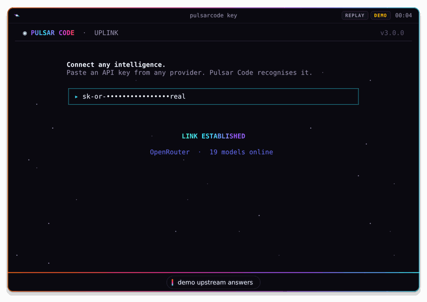</a>

<sub><b>Key uplink.</b> A fake OpenRouter-shaped key is recognised locally. <a href="assets/demo/uplink.svg">Play the recording</a>.</sub>

</td>
<td width="50%" valign="top">

<a href="assets/demo/picker.svg">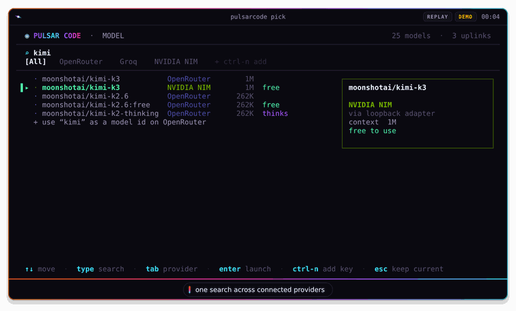</a>

<sub><b>Picker.</b> One search across your connected providers. <a href="assets/demo/picker.svg">Play the recording</a>.</sub>

</td>
</tr>
</table>

<details>
<summary><b>More recordings: boot, Stage, Observatory</b></summary>
<br>

<table>
<tr>
<td width="50%" valign="top">

<a href="assets/demo/boot.svg">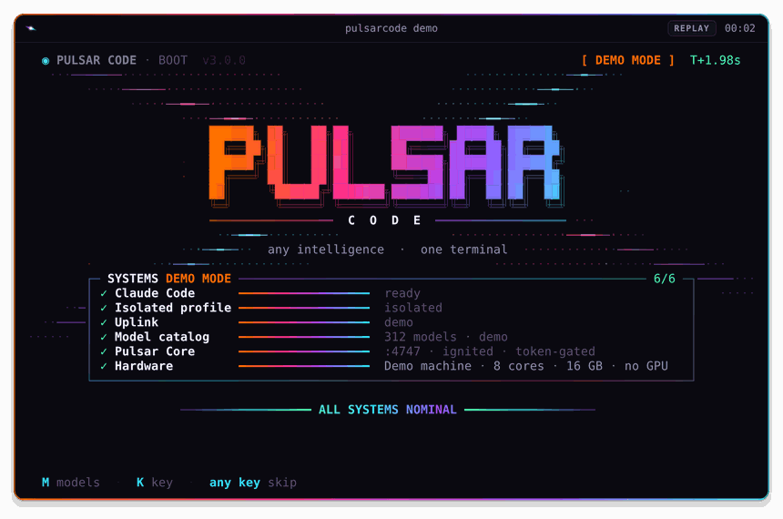</a>

<sub><b>Boot sequence</b> (<code>pulsarcode demo</code>).</sub>

</td>
<td width="50%" valign="top">

<a href="assets/demo/stage.svg">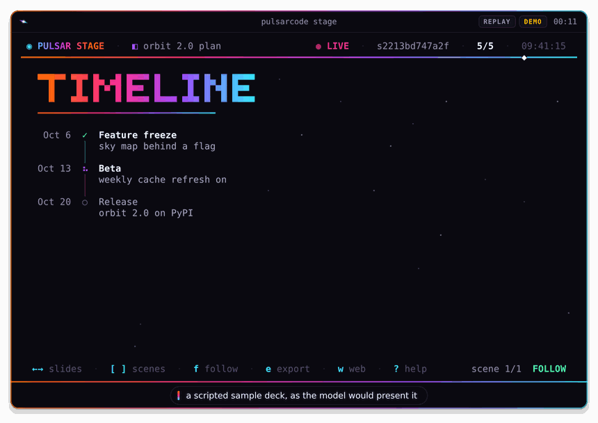</a>

<sub><b>Stage.</b> The model presents a deck in a split pane.</sub>

</td>
</tr>
<tr>
<td width="50%" valign="top">

<a href="assets/demo/top.svg">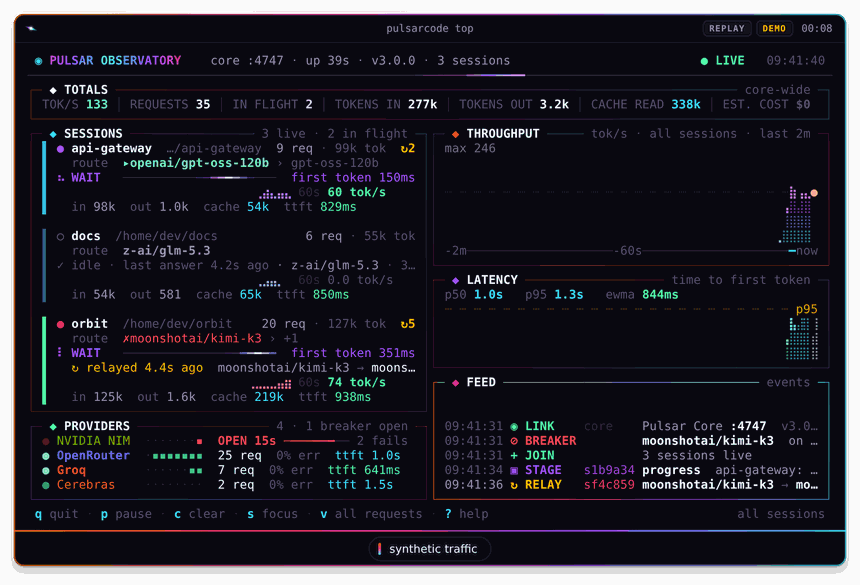</a>

<sub><b>Observatory.</b> Sessions, relays and breakers, live. Synthetic traffic.</sub>

</td>
<td width="50%" valign="top">

<sub>Each poster is the last frame of its recording; select one to play the animated SVG.</sub>

</td>
</tr>
</table>

</details>

<sub>Recorded in a sandbox with `tools/demo/make_all.sh` against a scripted stand-in for the
providers, with obviously fake keys. Model names, catalog counts, throughput, latency and the
boot panel's values (shown in demo mode) come from that demo stub and synthetic traffic: they
are illustrative, not measurements. The session recording shows Claude Code's own interface.</sub>

<picture>
  <source media="(max-width: 767px) and (prefers-color-scheme: dark)" srcset="assets/readme/divider-2-dark-still-v3.png">
  <source media="(max-width: 767px)" srcset="assets/readme/divider-2-light-still-v3.png">
  <source media="(prefers-reduced-motion: reduce) and (prefers-color-scheme: dark)" srcset="assets/readme/divider-2-dark-static.v3.svg">
  <source media="(prefers-reduced-motion: reduce)" srcset="assets/readme/divider-2-light-static.v3.svg">
  <source media="(prefers-color-scheme: dark)" srcset="assets/readme/divider-2-dark.v3.svg">
  
</picture>

## Features

<table>
<tr>
<td width="50%" valign="top">

<picture>
  <source media="(max-width: 767px) and (prefers-color-scheme: dark)" srcset="assets/readme/card-stage-dark-still-v3.png">
  <source media="(max-width: 767px)" srcset="assets/readme/card-stage-light-still-v3.png">
  <source media="(prefers-reduced-motion: reduce) and (prefers-color-scheme: dark)" srcset="assets/readme/card-stage-dark-static.v3.svg">
  <source media="(prefers-reduced-motion: reduce)" srcset="assets/readme/card-stage-light-static.v3.svg">
  <source media="(prefers-color-scheme: dark)" srcset="assets/readme/card-stage-dark.v3.svg">
  
</picture>

<sub><b>Stage.</b> The model presents decks, charts and diagrams.</sub>

</td>
<td width="50%" valign="top">

<picture>
  <source media="(max-width: 767px) and (prefers-color-scheme: dark)" srcset="assets/readme/card-council-dark-still-v3.png">
  <source media="(max-width: 767px)" srcset="assets/readme/card-council-light-still-v3.png">
  <source media="(prefers-reduced-motion: reduce) and (prefers-color-scheme: dark)" srcset="assets/readme/card-council-dark-static.v3.svg">
  <source media="(prefers-reduced-motion: reduce)" srcset="assets/readme/card-council-light-static.v3.svg">
  <source media="(prefers-color-scheme: dark)" srcset="assets/readme/card-council-dark.v3.svg">
  
</picture>

<sub><b>Council.</b> Answers side by side. Illustrative.</sub>

</td>
</tr>
<tr>
<td width="50%" valign="top">

<picture>
  <source media="(max-width: 767px) and (prefers-color-scheme: dark)" srcset="assets/readme/card-pilot-dark-still-v3.png">
  <source media="(max-width: 767px)" srcset="assets/readme/card-pilot-light-still-v3.png">
  <source media="(prefers-reduced-motion: reduce) and (prefers-color-scheme: dark)" srcset="assets/readme/card-pilot-dark-static.v3.svg">
  <source media="(prefers-reduced-motion: reduce)" srcset="assets/readme/card-pilot-light-static.v3.svg">
  <source media="(prefers-color-scheme: dark)" srcset="assets/readme/card-pilot-dark.v3.svg">
  
</picture>

<sub><b>Pilot.</b> Off by default; top-left corner failsafe.</sub>

</td>
<td width="50%" valign="top">

<picture>
  <source media="(max-width: 767px) and (prefers-color-scheme: dark)" srcset="assets/readme/card-observatory-dark-still-v3.png">
  <source media="(max-width: 767px)" srcset="assets/readme/card-observatory-light-still-v3.png">
  <source media="(prefers-reduced-motion: reduce) and (prefers-color-scheme: dark)" srcset="assets/readme/card-observatory-dark-static.v3.svg">
  <source media="(prefers-reduced-motion: reduce)" srcset="assets/readme/card-observatory-light-static.v3.svg">
  <source media="(prefers-color-scheme: dark)" srcset="assets/readme/card-observatory-dark.v3.svg">
  
</picture>

<sub><b>Observatory.</b> <code>pulsarcode top</code>. Demo data shown.</sub>

</td>
</tr>
</table>

- **Paste a key, pick a model.** Keys are recognised by shape without touching the network; ambiguous shapes (a bare `sk-...`) ask you to choose instead of trying the key against several vendors. `export OPENROUTER_API_KEY=...` lines, keys already exported in your shell, `https://host/v1` plus a key, and `ollama` / `lmstudio` work too. Admin keys (Anthropic, OpenAI), GitHub tokens, Stripe keys and Perplexity keys are refused.
- **Pulsar Stage.** The model presents decks, charts, diagrams, code, tables, metrics, timelines and progress. Inside Claude Code as a live pane on Claude Code 2.1.287 and later (its function-hooks plugin API is early access); otherwise a tmux, Zellij, WezTerm, kitty or Windows Terminal split (iTerm2 with `PULSAR_STAGE_VIEWER=split`), a browser view whose content security policy blocks all external requests, or a standalone HTML export. On macOS and Linux a run with no terminal opens nothing.
- **Decks and diagrams in the terminal.** Animated titles and transitions, layered diagrams with orthogonal arrows, code panels with highlighting. Degrades to ASCII, 16 colours, 40x12 and reduced motion.
- **Charts and the web view.** `pulsarcode stage --web` opens the same scenes in your browser, served by Pulsar Core on loopback. Decks export to standalone HTML.
- **Observatory (`pulsarcode top`).** Live sessions, tokens per second, time to first token, relays, circuit breakers, cache reads and estimated cost. `--once` and `--json` for pipes.
- **Pilot (opt-in computer use).** Off by default; you arm it with `pulsarcode pilot on` in your own terminal, and it refuses inside a Claude Code session. Pilot actions are not pre-approved: Claude Code's permission system decides, and in its default mode it asks you each time. It has a failsafe corner (top-left), a limit of 10 actions per second and a local audit log that records neither typed text nor images. Input is refused when the window in front changed since the model's last screenshot (where the system reports it), and shortcuts that log out, lock, force-quit or power off are never pressed. A session with Pilot armed never relays, so screenshots go only to the model you chose. X11, macOS and Windows; Wayland input is not supported. `pulsarcode pilot tour` shows the cursor without moving anything.

<details>
<summary><b>Screenshots</b></summary>
<br>

<table>
<tr>
<td width="50%" valign="top"><a href="assets/screens/boot.png">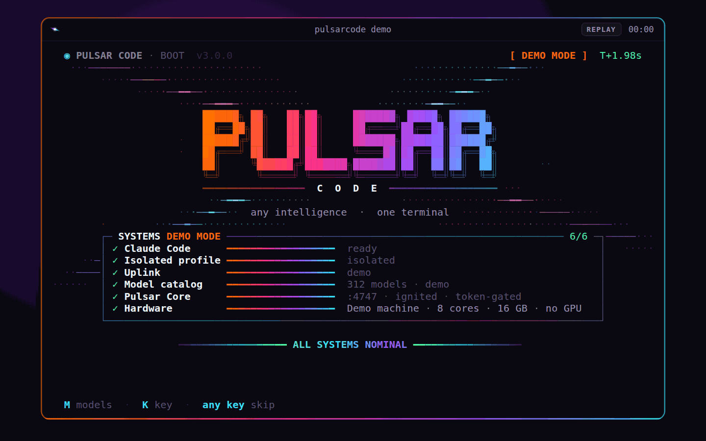</a><br><sub>Boot screen with the PULSAR wordmark and the SYSTEMS panel checking Claude Code, profile, uplink, catalog, Core and hardware</sub></td><td width="50%" valign="top"><a href="assets/screens/stage-pane.png">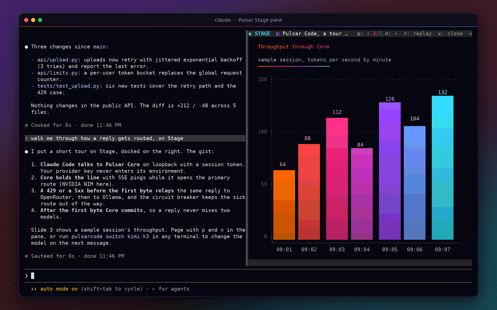</a><br><sub>Pulsar Stage docked as a pane inside Claude Code, showing a bar chart next to the transcript</sub></td>
</tr>
<tr>
<td width="50%" valign="top"><a href="assets/screens/stage-deck.png">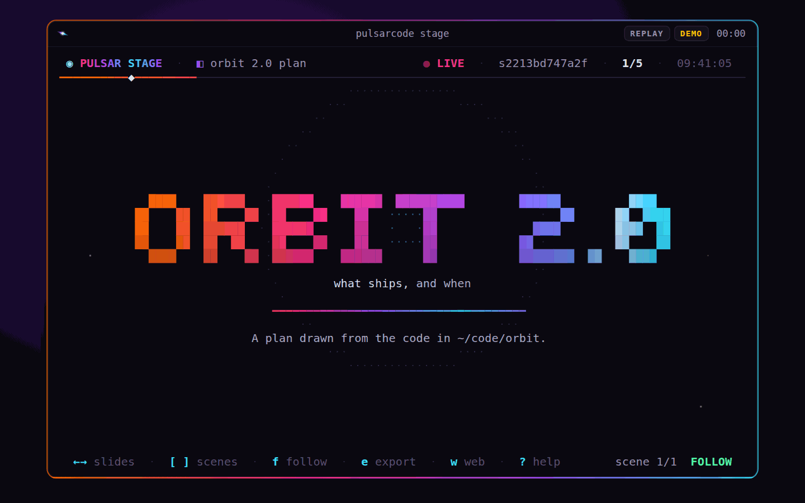</a><br><sub>Pulsar Stage terminal viewer showing a title slide</sub></td><td width="50%" valign="top"><a href="assets/screens/stage-diagram.png">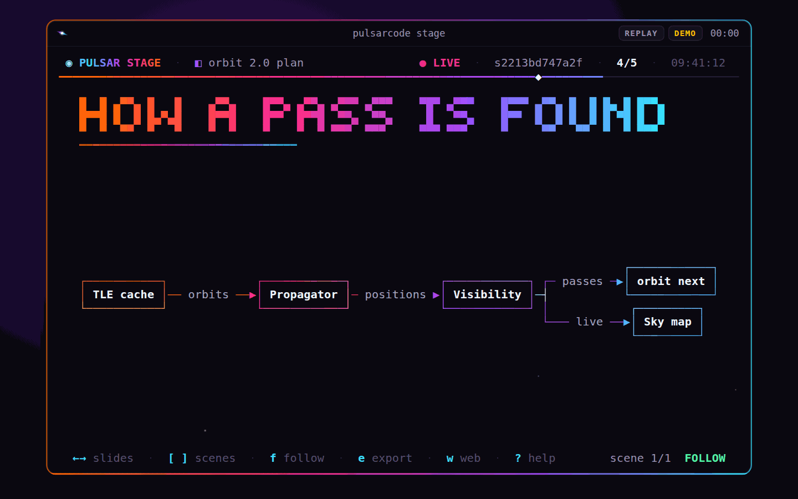</a><br><sub>Pulsar Stage diagram scene with boxes and orthogonal arrows</sub></td>
</tr>
<tr>
<td width="50%" valign="top"><a href="assets/screens/stage-chart.png">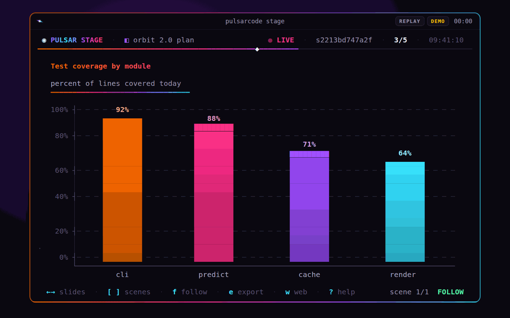</a><br><sub>Pulsar Stage chart scene</sub></td><td width="50%" valign="top"><a href="assets/screens/stage-web.png">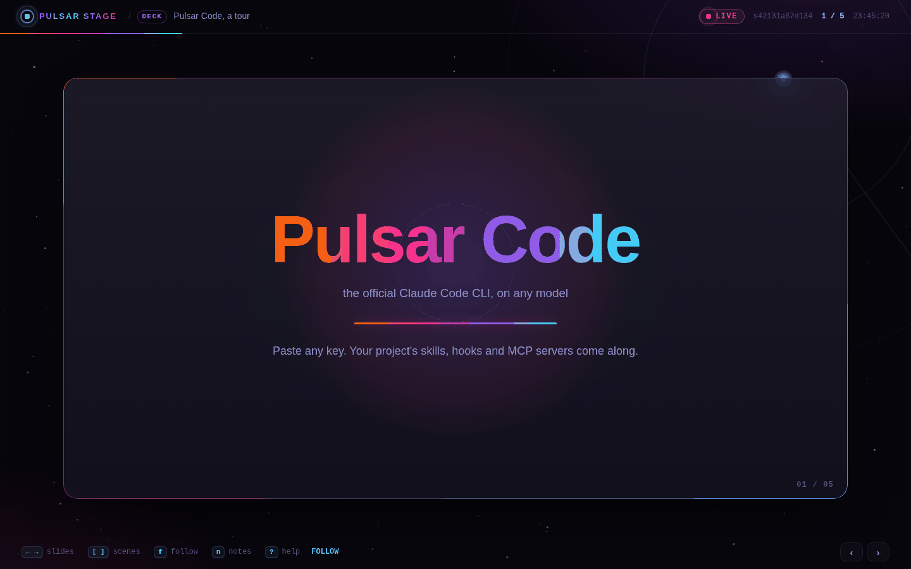</a><br><sub>Pulsar Stage web view in a browser</sub></td>
</tr>
<tr>
<td width="50%" valign="top"><a href="assets/screens/observatory.png">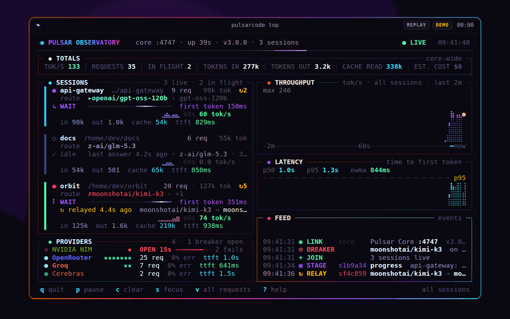</a><br><sub>Pulsar Observatory dashboard with sessions, throughput, latency, providers and an event feed</sub></td><td width="50%" valign="top"><a href="assets/screens/pilot-cursor.png">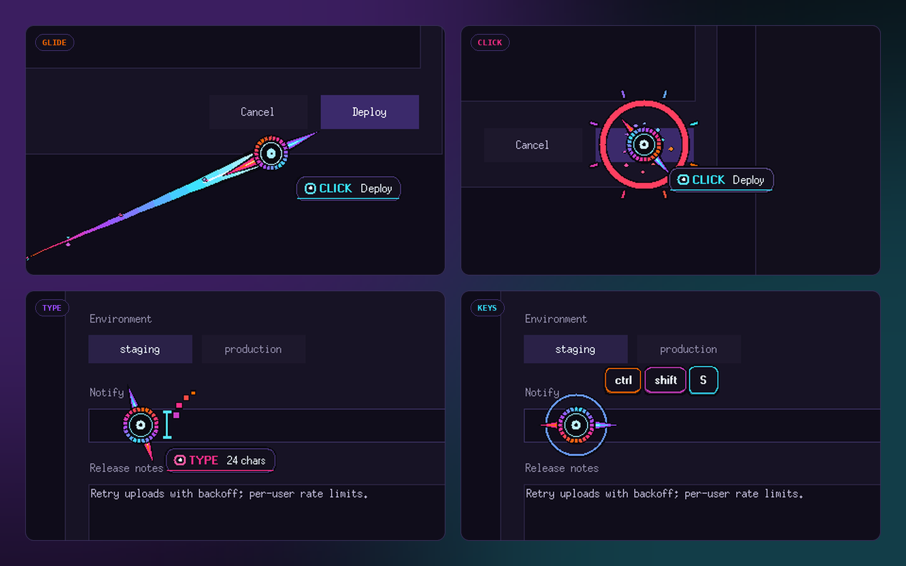</a><br><sub>The animated pulsar cursor gliding, clicking, typing and pressing keys</sub></td>
</tr>
</table>

</details>

Also in the box:

- **Council.** Ask your other connected models the same question and get the answers side by side
  (`/pulsar:council <question>`).
- **Live model hot swap.** `/pulsar:switch <model>` inside the session, `pulsarcode switch <model>`
  from another terminal, or Claude Code's own `/model`. It takes effect on the next message, no
  restart.
- **Relay.** When a provider returns 429, 5xx, times out or rejects the key before the first byte
  of the answer, the same request goes to the next target in your relay chain. Automatic relay
  stays among the listed hosted providers; a local server or a custom URL never relays on its own.
- **Translation that holds up with open models.** Fresh tool ids, tool calls emitted as text are
  rescued where a call can stand (markup quoted in prose stays text), names over 64 characters get a
  stable alias, arguments are coerced to the tool's schema,
  a tool call that was cut off mid-arguments is withheld instead of being run, and a reply that
  arrives only as reasoning when Claude Code did not ask for thinking is shown as the answer, never
  as an empty reply.
- **Self-healing requests.** A rejected parameter (`max_tokens` caps, `max_completion_tokens`,
  `temperature` on reasoning models, `stream_options`, strict schemas, images) is adjusted and
  retried, and the fix is remembered per model for a week.
- **Correct context accounting.** Claude Code compacts inside the model's real window: windows of
  1M and more use Claude Code's 1M mode, windows below 200k move auto-compaction to the real size,
  and windows between 200k and 1M are used as 200k. Provider overflow errors come back as
  Anthropic's own "prompt is too long", so compaction engages.
- **Loop guard.** If the model repeats the identical step four times, Pulsar answers with an
  explanation instead of calling the provider again (`PULSAR_LOOPGUARD=0` turns it off).

### Providers

Pulsar Code v3.0.0 has 36 provider profiles (counted on 2026-10-02 with `pulsar.screens.advertised_providers()`),
plus any OpenAI-compatible URL, or an Anthropic Messages URL that ends in `/anthropic`:

- **Frontier labs and their APIs:** Anthropic, OpenAI, Google Gemini, xAI, Mistral, Cohere,
  DeepSeek, Moonshot Kimi, Z.ai GLM, MiniMax, Alibaba Qwen
- **Fast inference and hosts:** NVIDIA NIM, Groq, Cerebras, SambaNova, Together AI, Fireworks AI,
  DeepInfra, Novita AI, Nebius Token Factory, Hugging Face, Venice, Chutes
- **Gateways:** OpenRouter, Vercel AI Gateway, Requesty
- **Clouds:** Azure OpenAI, Azure AI Foundry (Claude), Amazon Bedrock, Google Vertex AI
- **On your machine:** Ollama, LM Studio, llama.cpp, vLLM, Jan, LocalAI

Connect as many as you like. They all appear in one picker, and `pulsarcode use <provider>`
switches the active one.

<picture>
  <source media="(max-width: 767px) and (prefers-color-scheme: dark)" srcset="assets/readme/divider-3-dark-still-v3.png">
  <source media="(max-width: 767px)" srcset="assets/readme/divider-3-light-still-v3.png">
  <source media="(prefers-reduced-motion: reduce) and (prefers-color-scheme: dark)" srcset="assets/readme/divider-3-dark-static.v3.svg">
  <source media="(prefers-reduced-motion: reduce)" srcset="assets/readme/divider-3-light-static.v3.svg">
  <source media="(prefers-color-scheme: dark)" srcset="assets/readme/divider-3-dark.v3.svg">
  
</picture>

## How it works

<picture>
  <source media="(max-width: 767px) and (prefers-color-scheme: dark)" srcset="assets/readme/signal-dark-still-v3.png">
  <source media="(max-width: 767px)" srcset="assets/readme/signal-light-still-v3.png">
  <source media="(prefers-reduced-motion: reduce) and (prefers-color-scheme: dark)" srcset="assets/readme/signal-dark-static.v3.svg">
  <source media="(prefers-reduced-motion: reduce)" srcset="assets/readme/signal-light-static.v3.svg">
  <source media="(prefers-color-scheme: dark)" srcset="assets/readme/signal-dark.v3.svg">
  
</picture>

<sub>Before the first 200, any target may fail and the next in the session plan takes over. After it, Pulsar Core streams only from that target.</sub>

<picture>
  <source media="(max-width: 767px) and (prefers-color-scheme: dark)" srcset="assets/readme/constellation-dark-still-v3.png">
  <source media="(max-width: 767px)" srcset="assets/readme/constellation-light-still-v3.png">
  <source media="(prefers-reduced-motion: reduce) and (prefers-color-scheme: dark)" srcset="assets/readme/constellation-dark-static.v3.svg">
  <source media="(prefers-reduced-motion: reduce)" srcset="assets/readme/constellation-light-static.v3.svg">
  <source media="(prefers-color-scheme: dark)" srcset="assets/readme/constellation-dark.v3.svg">
  
</picture>

<sub>36 provider profiles in v3.0.0, by route: local 6 · native 6 · cloud 2 · keyed adapters 22.</sub>

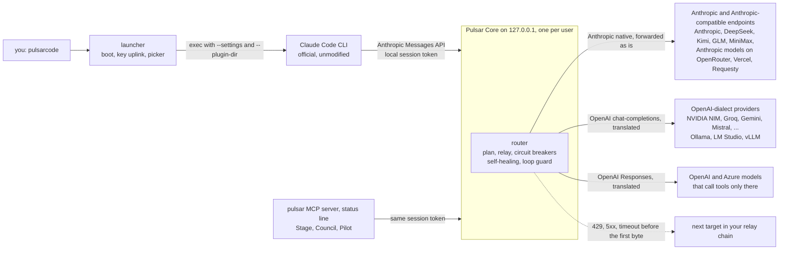

Claude Code supports alternative backends through its documented `ANTHROPIC_BASE_URL` setting.
`pulsarcode` registers a session with **Pulsar Core**, a router that listens on `127.0.0.1` only
(port 4747 by default) and is shared by all your sessions. Claude Code gets a random local session
token; your provider key stays with Core. For each request Core picks one wire per model:
Anthropic Messages passed through untranslated, OpenAI chat-completions, or the OpenAI Responses API.
It keeps Claude Code waiting with SSE pings while it opens the provider, relays to the next target
on a failure before the first byte, and commits to the first target that answers.

Amazon Bedrock and Google Vertex AI take a different route: Claude Code talks to the cloud
directly with its own auth, and Core is only a side channel for Stage, Council and the status line.
Core stops by itself shortly after your last session ends. The full design is in
[docs/ARCHITECTURE.md](docs/ARCHITECTURE.md).

<picture>
  <source media="(max-width: 767px) and (prefers-color-scheme: dark)" srcset="assets/readme/divider-4-dark-still-v3.png">
  <source media="(max-width: 767px)" srcset="assets/readme/divider-4-light-still-v3.png">
  <source media="(prefers-reduced-motion: reduce) and (prefers-color-scheme: dark)" srcset="assets/readme/divider-4-dark-static.v3.svg">
  <source media="(prefers-reduced-motion: reduce)" srcset="assets/readme/divider-4-light-static.v3.svg">
  <source media="(prefers-color-scheme: dark)" srcset="assets/readme/divider-4-dark.v3.svg">
  
</picture>

## Do you need Pulsar Code?

**If one provider with a native Anthropic endpoint is all you need, set `ANTHROPIC_BASE_URL`
and you may not need Pulsar.** Recent Ollama versions and OpenRouter can talk to Claude Code
directly, and DeepSeek, Kimi, GLM and MiniMax publish Anthropic-compatible endpoints. Set
`ANTHROPIC_BASE_URL` and `ANTHROPIC_AUTH_TOKEN` and go. That is a fine setup.

Pulsar Code earns its place when:

1. **Your provider speaks only the OpenAI wire** (no Anthropic Messages endpoint that Pulsar has
   verified): NVIDIA NIM, Groq, Cerebras, Gemini, Mistral, Fireworks, xAI, Cohere, Nebius, Venice,
   Chutes, Azure OpenAI, vLLM, Jan, LocalAI, and OpenAI models that call tools only through the
   Responses API. Something has to translate, and translation is where the bugs live.
2. **You use more than one provider:** one picker across all of them, hot swap mid-session, and
   relay when a provider returns 429 or 5xx or times out before answering.
3. **You run open models:** tool ids reused across turns, tool calls emitted as text, calls cut
   off mid-arguments, tool names over 64 characters, base64 images counted as text. Each of these
   breaks a plain gateway setup in a specific way that Pulsar handles.
4. **You want correct context accounting:** Claude Code compacts inside the model's real window
   (up to its 1M mode; windows between 200k and 1M are used as 200k), and provider overflow errors
   come back as "prompt is too long" so compaction engages.
5. **You want your upstream key out of Claude Code's environment** and your `~/.claude` untouched.
6. **You want the extras:** Stage, Council, Pilot, Observatory.

What it costs you: one more local process; a translation layer that can lag behind a new Claude
Code field (self-healing narrows that gap, it does not close it); and a configuration Anthropic
does not support.

---

## Privacy

What leaves your machine in the default configuration:

| What | Where it goes |
|---|---|
| Your prompts, code and tool results | **The provider and model you picked.** |
| The same request, if that provider fails before answering | **Your relay chain.** The default (`auto`) relays only when the provider you picked is one of the listed hosted providers, and only to up to two other listed hosted providers that have a model chosen. A local server or a custom URL as primary never relays automatically, and local servers, custom URLs, Bedrock and Vertex are never automatic relay targets (a listed provider pointed at a host on your machine or local network counts as local). A session with Pilot armed never relays. Turn relay off with `pulsarcode relay off`, or name the chain yourself (`pulsarcode relay openrouter:z-ai/glm-5.3`), which works from any primary. `pulsarcode relay` shows the current chain. |
| A question sent to Council | **Other connected providers** (by default the session's other models, up to four; a session with one model asks it together with up to two of its provider's recommended models from other vendors, on the same key; or the models named in the call). Council is not pre-approved: Claude Code asks for permission before the tool runs, except when you typed `/pulsar:council` yourself, which allows it for that command. |
| Anything, to PulsarOS | **Nothing.** There is no Pulsar server, account or analytics. |
| Your API keys | **Only the provider each key was matched to.** Stored in `~/.pulsarcode/keys.json` (0600, directory 0700, atomic writes). Never sent over plain `http` to a host outside your machine and local network (unless `PULSAR_ALLOW_HTTP=1`), nor to a URL that carries a user name or password. On the default route Claude Code only ever sees a local session token, and provider keys exported in your shell are removed from its environment (`PULSAR_KEEP_ENV_KEYS=1` keeps them). Deny rules keep Claude Code's Read and Edit tools away from Pulsar's keys, tokens and logs, and its Edit tool away from what Pulsar runs; the isolated profile stays editable. |
| Telemetry | **None from Pulsar.** Claude Code telemetry, error reporting, non-essential traffic and auto-update are switched off for Pulsar sessions. |

Other network traffic: model catalogs come from the model-list endpoints of the providers you
connected; the installer and `pulsarcode update` download from GitHub, install Pulsar Code's Python
dependencies from PyPI (`pypi.org`, `files.pythonhosted.org`), and fetch uv from `astral.sh` and
Anthropic's official installer when those are missing. With `PULSARCODE_LOCAL_ENDPOINT` set,
Pulsar checks at launch whether that server answers; unset, nothing is probed. Requests to
OpenRouter carry its attribution headers (`HTTP-Referer` set to this repository,
`X-Title: Pulsar Code`).

On non-Claude models Pulsar turns Claude Code's commit and pull request attribution off, so no line
credits a Claude model for another model's work; `PULSAR_ATTRIBUTION=on` writes a "Built with Pulsar
Code" line naming the model instead. With Anthropic and on the cloud routes, Claude Code keeps its
own attribution.

Error and diagnostic text from upstreams is scrubbed of your key and known key shapes before it
reaches Claude Code, the event bus, stats or a council answer. Pulsar runs Claude Code with an
isolated profile in `~/.pulsarcode/claude_config`, so your `~/.claude` is not touched unless you
set `PULSAR_CLAUDE_CONFIG=shared`. Then Pulsar does not set `CLAUDE_CONFIG_DIR` (a value you set
yourself is kept), so Claude Code reads its configuration as it does when you run `claude`
directly. The threat model is in [SECURITY.md](SECURITY.md).

---

## FAQ

**Is this allowed under Anthropic's terms?**
Pulsar Code starts the official Claude Code CLI you installed, unmodified, and configures it through
the LLM gateway variables (`ANTHROPIC_BASE_URL`) and other environment variables, a per-session
settings file and a plugin directory. It also pre-seeds the isolated profile's first-run state:
onboarding done, the gateway billing notice acknowledged for sessions through Pulsar Core (where
Claude Code reaches a provider itself, the notice is left for you to read), and on the direct Anthropic route
(`PULSAR_DIRECT=1`) your own Anthropic API key approved in that profile. It
does not patch, bundle or redistribute Claude Code, and it has no Anthropic account or access of
its own: you bring a key for each provider you use. Anthropic does not support routing Claude Code
to non-Claude models, so this is an unsupported configuration and a Claude Code update can change
behavior. Your use of Claude Code stays subject to Anthropic's
terms, and each model provider's terms apply to its models. Read the terms that apply to you; this
is not legal advice.

**Does Anthropic support or endorse this?**
No. Pulsar Code is an independent project. Please report problems to Pulsar Code, not to
Anthropic. See the [disclaimer](#disclaimer).

**Which models work?**
Any model your connected providers serve, but Claude Code is an agent: models with strong tool
calling do best. The picker ranks each connected catalog, marks models that cannot call tools and
models that reason before answering, and suggests a tier. The honest answer is to try two or three
on your own work; switching is one command and the Observatory shows how each one behaves.

**Do my skills, hooks, MCP servers and plugins come along?**
Your project's do: the `.claude/` folder and `.mcp.json` in the folder you work in are read as
usual. Your user-level setup in `~/.claude` does not by default, because Pulsar launches Claude
Code with its own isolated profile. To bring user-level skills into that profile, name them:
`PULSAR_SKILLS=skill-a,skill-b` copies those skill folders from `~/.claude/skills` (or from the
folders in `PULSAR_SKILLS_DIRS`, separated like `PATH` entries) into the isolated profile at each
launch. Or set `PULSAR_CLAUDE_CONFIG=shared` to use your own `~/.claude` as it is.

**How are updates handled?**
Pulsar Code: `pulsarcode update` installs the latest release tag, checked against its
`SHA256SUMS`, and `pulsarcode update vX.Y.Z` installs a tag you name. It never installs a tag older
than v3.0.0, and never moves to a version older than the one running unless you add
`--allow-downgrade`. When the latest release cannot be found it stops and says so; it never falls
back to `main` on its own (`pulsarcode update main` installs `main` when you ask for it). An exported
`PULSAR_REF` is for the installer only: `pulsarcode update` follows the ref you pass it. Release
tags arrive with the first public release; until then, update an install from the clone it was made from.
Package-manager installs print their own upgrade command instead.
Claude Code: Pulsar sessions switch off Claude Code's auto-updater (`PULSAR_CLAUDE_AUTOUPDATE=1`
turns it back on), so a Pulsar session does not update Claude Code by itself. Pulsar runs the same
`claude` binary you use directly, though, so if you also run `claude` on its own, its updater can
update that binary and Pulsar then uses the new version. Pulsar v3.0.0 was tested with Claude Code
2.1.287 through 2.1.296, and the [compat workflow](.github/workflows/compat.yml) runs Claude Code's stable and
latest npm releases through Pulsar against scripted providers every Monday and on demand.

**I used pulsarcode v1. What changes?**
Your NVIDIA key, active model and model history are imported on the first launch, and Pulsar says
so in one line. The v1 key file is then kept as `nim.key.migrated` (0600) and never imported again;
`pulsarcode logout nvidia` removes it. When Pulsar imports or adopts an NVIDIA key,
`NVIDIA_NIM_API_BASE` becomes that profile's base URL. The v1 timeout and ping variables
(`PULSAR_NIM_*`) still work as fallbacks of the new `PULSAR_*` names. Subcommands of earlier
launchers (`local`, `nim`, `nvidia`, `kimi`, `gemma`, `qwen`, `sonar-pick`) are refused with a
one-line hint; they never reach Claude Code as a prompt. The [CHANGELOG](CHANGELOG.md) has the full
migration notes.

**Does Windows work?**
Native Windows (PowerShell 5.1 or later) is experimental. WSL gives the smoothest ride. Pilot has a
Windows backend, and Stage opens in a Windows Terminal split when it can, else in the browser.

**Does it work offline with local models?**
Yes. Ollama, LM Studio, llama.cpp, vLLM, Jan and LocalAI servers on your machine are found on
loopback, and the key prompt offers one it finds (`PULSAR_OFFLINE=1` skips that lookup); or type
`ollama` at the key prompt or paste a local URL. Local model servers bypass your HTTP proxy unless
you set `PULSAR_PROXY_LOCAL=1`. For a server you host elsewhere, set
`PULSARCODE_LOCAL_ENDPOINT` to its OpenAI-compatible URL (or to an Anthropic Messages URL ending
in `/anthropic`): Pulsar adds it as a custom profile and prefers it at launch while it answers.

**What does it cost?**
Pulsar Code is free software under the AGPL-3.0-or-later. Model usage is between you and your
providers; several have free tiers, and local models run on your own hardware.

**Can I use it in scripts and CI?**
Yes. With `-p`/`--print`, or without a TTY, Pulsar skips the animation and prompts. Export a key
(for example `OPENROUTER_API_KEY`) and run `pulsarcode -p "..."`. To store a key without typing it,
use `printf %s "$KEY" | pulsarcode key --stdin` or `pulsarcode key --from-env VAR`; never pass a
key as a command argument.

**Something is not working.**
`pulsarcode status` checks the key, Core, the catalogs and Claude Code in one pass. `PULSAR_LOG=1 pulsarcode` writes Core's log to
`~/.pulsarcode/logs/core.log`. Ollama silently truncates Claude Code's large system prompt at its
default context size: start it with a bigger window (`OLLAMA_CONTEXT_LENGTH=65536 ollama serve`)
and pick a tool-capable model. In a terminal without arrow keys, `PULSAR_FX=plain pulsarcode pick`
gives a numbered picker.

---

## Commands

| Command | What it does |
|---|---|
| `pulsarcode` | Boot, connect if needed, launch Claude Code through Pulsar Core |
| `pulsarcode [claude args]` | Anything else goes to Claude Code (`pulsarcode -p "explain this repo"`, `pulsarcode --continue`) |
| `pulsarcode key` | Connect a provider: paste any API key, URL or `ollama` at a masked prompt (`--stdin`, `--from-env VAR`) |
| `pulsarcode providers` | Everything Pulsar Code can talk to |
| `pulsarcode use <provider>` | Switch the active provider profile |
| `pulsarcode logout [provider]` | Forget a stored key |
| `pulsarcode pick` | Choose a model across your connected providers |
| `pulsarcode switch <model>` | Hot-swap a running session (the single running one, or `--session <id>` / `--all`) |
| `pulsarcode model [id]` | Show or set the default model (`provider:id` also works) |
| `pulsarcode models [query]` | List models (`--json`, `--refresh`, `--top N`) |
| `pulsarcode relay [auto\|off\|profile:model ...]` | Show or set the relay chain |
| `pulsarcode top` | Observatory: live sessions, tokens per second, latency, relays |
| `pulsarcode stage` | Stage viewer for what the model presents (`--web` for the browser) |
| `pulsarcode status` | Health check (alias: `doctor`) |
| `pulsarcode demo` | Replay the boot sequence (demo mode, illustrative values) |
| `pulsarcode pilot on\|off\|status\|tour` | Computer use with the pulsar cursor (off by default); `status --gui` also tests the cursor window |
| `pulsarcode stop` | Stop Pulsar Core once its live sessions end (`--force` stops it now) |
| `pulsarcode update [ref]` | Install the latest release, a tag you name (v3.0.0 or later) or `main`; `--allow-downgrade` to go back to an older version |
| `pulsarcode uninstall` | Remove Pulsar Code (Claude Code stays) |
| `pulsarcode version` | Print the version |

Inside a Claude Code session:

| Command | What it does |
|---|---|
| `/pulsar:status` | Route, model, relay chain and session stats |
| `/pulsar:switch <model>` | Move this session to another model on the next message (no arguments lists models) |
| `/pulsar:stage [topic]` | Present the topic, or the work so far, on Pulsar Stage |
| `/pulsar:council <question>` | Ask the other connected models and compare their answers |
| `/model` | Claude Code's own model switch |

Run `key`, `logout`, `update`, `uninstall` and `pilot on` in your own terminal. From inside a Claude
Code session `pilot on` is refused, and the others refuse unless you confirm at a real terminal by
typing `I am human`. These checks catch a model's shell as it normally runs; Claude Code's
permission prompt, which asks you before a command runs, remains the boundary. Subcommands of
earlier launchers (`local`, `nim`, `nvidia`, `kimi`, `gemma`, `qwen`, `sonar-pick`) are refused with
a one-line hint on what replaces them.

---

## Configuration

| Variable | Default | Effect |
|---|---|---|
| `PULSAR_HOME` | `~/.pulsarcode` | State folder: keys, profiles, isolated Claude Code profile, caches, logs. Empty means the default; a relative path, a folder another user owns or others can write to, or one Pulsar cannot tell is its own is refused |
| `PULSAR_PORT` | `4747` | First loopback port Pulsar Core tries |
| `PULSAR_CLAUDE_CONFIG` | isolated | `shared` runs Claude Code with your own `~/.claude` (Pulsar then leaves `CLAUDE_CONFIG_DIR` as you set it, or unset) |
| `PULSAR_SKILLS` | empty | Comma-separated skill folder names copied into the isolated profile at launch (not with `shared`) |
| `PULSAR_SKILLS_DIRS` | `~/.claude/skills` | Folders `PULSAR_SKILLS` copies from, separated like `PATH` (`:`, or `;` on Windows); the first that has a skill wins |
| `PULSARCODE_LOCAL_ENDPOINT` | unset | A self-hosted OpenAI-compatible URL, or an Anthropic Messages URL ending in `/anthropic`: added as a custom profile and preferred at launch while it answers; `0`, `off`, `none`, `false` or an empty value switch it off. Alias: `PULSAR_LOCAL_ENDPOINT` |
| `PULSARCODE_PREFER_LOCAL` | `1` | `0` keeps that endpoint as a profile without preferring it at launch |
| `PULSAR_RELAY` | `auto` | `off` turns relay off in that shell, even over a chain saved with `pulsarcode relay`; `auto` (when nothing was saved) relays only among the listed hosted providers |
| `PULSAR_KEEP_ENV_KEYS` | unset | `1` lets Claude Code see provider keys exported in your shell |
| `PULSAR_ALLOW_HTTP` | unset | `1` allows sending a key over plain `http` to a non-local host |
| `PULSAR_DIRECT` | unset | `1` sends Claude Code straight to an Anthropic-native provider, bypassing Core for chat |
| `PULSAR_LOOPGUARD` | `1` | `0` disables the loop guard |
| `PULSAR_SHOW_REASONING` | `1` | `0` hides model reasoning |
| `PULSAR_HEADER_TIMEOUT[_REASONING]` | `180` / `420` s | Wait for the provider to start answering |
| `PULSAR_FIRST_TOKEN_TIMEOUT[_REASONING]` | `120` / `420` s | Wait for the first token once the stream opens |
| `PULSAR_RETRIES` | `2` | Transient retries on the last target in the chain before giving up |
| `PULSAR_LOG` | unset | `1` writes Core's log to `~/.pulsarcode/logs/core.log` |
| `PULSAR_CA_BUNDLE` | unset | CA bundle for TLS (also honoured: `SSL_CERT_FILE`, `REQUESTS_CA_BUNDLE`, `CURL_CA_BUNDLE`, `NODE_EXTRA_CA_CERTS`) |
| `PULSAR_PROXY_LOCAL` | unset | `1` sends local model servers through `HTTP(S)_PROXY` too |
| `PULSAR_CLAUDE_BIN` | found on PATH | Path to the `claude` binary to launch |
| `PULSAR_CLAUDE_AUTOUPDATE` | unset | `1` lets Claude Code auto-update inside Pulsar sessions |
| `PULSAR_PLUGIN` | `on` | `off` launches Claude Code without the Pulsar plugin (no Stage, Council or `/pulsar:*`) |
| `PULSAR_STATUSLINE` | `on` | `off` launches without the Pulsar status line |
| `PULSAR_ATTRIBUTION` | `off` | `on` sets Claude Code's commit and PR attribution to a "Built with Pulsar Code" line naming the model; off, non-Claude models get no attribution line (Claude routes keep Claude Code's own) |
| `PULSAR_PILOT` | unset | `1` arms Pilot for a launch you start yourself at a terminal; `0` keeps it off for that launch (`pulsarcode pilot on` / `off` is the lasting switch) |
| `PULSAR_AUTO_MODE` | `on` | `off` turns Claude Code's auto mode off in Pulsar sessions |
| `PULSAR_STAGE_VIEWER` | `auto` | `split`, `browser` or `none`: where Stage opens when the model presents (`split` also uses iTerm2; on macOS and Linux a run with no terminal opens nothing) |
| `PULSAR_STAGE_PANE` | on | `off` disables the Stage pane inside Claude Code |
| `PULSAR_FX` | `auto` | `full`, `lite`, `minimal`, `off` (no animation) or `plain` (line-mode prompts) |
| `PULSAR_REDUCED_MOTION` | unset | `1` keeps the UI and drops motion effects |
| `PULSAR_HAPTICS` | `on` | Visual pulse feedback; `bell` adds the terminal bell; `off` disables it |
| `PULSAR_NOTIFY` | `on` | Attention pings: `bell`, `os` (system notifier), `loud` or `off` |
| `NO_COLOR` | unset | Monochrome output |
| `PULSAR_ASCII` | unset | `1` uses ASCII glyphs only |
| `PULSAR_OFFLINE` | unset | `1` never fetches model catalogs or looks for local model servers |
| `PULSAR_REF` | `main` | Branch or tag the installer fetches; a release tag is checked against `SHA256SUMS`. `pulsarcode update` does not read it: pass the ref as an argument |

Advanced: `PULSAR_BEHAVES_AS` (default `claude-sonnet-4-5`) names the Claude model whose request
profile Claude Code applies to a Pulsar model; `PULSAR_PING_INTERVAL` is how often Core pings Claude
Code while a provider is opened (seconds, default `5`); `PULSAR_MAX_BODY` caps Core's request bodies
(bytes, default 32 MiB); `PULSAR_CORE_HEADER_TIMEOUT` is how long a local connection to Core may
take to send its request head (seconds, default `15`; the provider wait is `PULSAR_HEADER_TIMEOUT`);
`PULSAR_CORE_GRACE` is how long a new Core keeps running without a session (seconds, default `120`)
and `PULSAR_CORE_IDLE` the longest it stays up without activity when no session is live (seconds,
default `43200`).

Installer settings (`install.sh`, `install.ps1`): `PULSAR_REF`, `PULSAR_HOME`, `PULSAR_BIN_DIR`
(where the `pulsarcode` command goes), `PULSAR_NO_LAUNCH=1`, `PULSAR_SKIP_CLAUDE=1` and
`PULSAR_NO_PATH=1`. A `PULSAR_HOME` that holds files Pulsar Code did not create is refused, with the
names in the way, and nothing is written there; the installed command always runs against the home
it was installed into. `install.sh` does not replace a `pulsarcode` command another install made
unless you set `PULSAR_FORCE=1`.

---

## Requirements

- **macOS, Linux or WSL** with `bash`, `tar` and `curl` (or `wget`). **Windows:** PowerShell 5.1
  or later (experimental).
- Python 3.9 or later is used if present; otherwise the installer fetches
  [uv](https://github.com/astral-sh/uv) and a private Python runtime.
- Claude Code: installed with Anthropic's official installer if you do not have it.
- A UTF-8 terminal. Truecolor when available, with fallbacks to 256 and 16 colours and ASCII.

## Uninstall

```bash
pulsarcode uninstall
```

This removes `~/.pulsarcode` (keys, settings, the isolated Claude Code profile), the `pulsarcode`
command and its `PATH` entry, after asking. It refuses a `PULSAR_HOME` it cannot tell is Pulsar's,
keeps files in the home that Pulsar did not create and a `PATH` entry whose folder holds other
programs, and prints the command that drops a folder fish keeps in its universal `fish_user_paths`.
Claude Code itself is left installed. Package-manager installs (pipx, uv, Homebrew, Scoop and npm,
coming with the first public release) are removed with that package manager.

---

## Project

Open source under AGPL-3.0-or-later and maintained by
[PulsarOS Intelligence Inc.](https://pulsaros.ca), Ottawa, Canada. See
[CONTRIBUTING.md](CONTRIBUTING.md) for how the project takes input, [SECURITY.md](SECURITY.md) to
report a vulnerability, and [CHANGELOG.md](CHANGELOG.md) for what changed.

<picture>
  <source media="(max-width: 767px) and (prefers-color-scheme: dark)" srcset="assets/readme/footer-dark-still-v3.png">
  <source media="(max-width: 767px)" srcset="assets/readme/footer-light-still-v3.png">
  <source media="(prefers-reduced-motion: reduce) and (prefers-color-scheme: dark)" srcset="assets/readme/footer-dark-static.v3.svg">
  <source media="(prefers-reduced-motion: reduce)" srcset="assets/readme/footer-light-static.v3.svg">
  <source media="(prefers-color-scheme: dark)" srcset="assets/readme/footer-dark.v3.svg">
  
</picture>

## Disclaimer

Claude and Claude Code are trademarks of Anthropic PBC. Pulsar Code is independent and not
affiliated with or endorsed by Anthropic. Anthropic does not support routing Claude Code to
non-Claude models; a Claude Code update can change behavior.

Other product names belong to their owners and are used only to say what Pulsar Code can connect
to. You need your own access to each provider you connect, and their terms apply.

## License

AGPL-3.0-or-later. See [LICENSE](LICENSE).
